<div align="center">

# ⚡ RepoSage

### *Autonomous AI Software Engineering, Verification & Continuous Observability Platform*

[](https://react.dev/)
[](https://www.typescriptlang.org/)
[](https://vitejs.dev/)
[](https://tailwindcss.com/)
[](https://ai.google.dev/)
[](https://kubernetes.io/)
[](LICENSE)

<br/>

<p align="center">
  <strong>Analyze repositories</strong> &bull;
  <strong>Synthesize test-gated AI patches</strong> &bull;
  <strong>Automate container builds</strong> &bull;
  <strong>Execute canary deployments</strong> &bull;
  <strong>Observe real-time telemetry</strong>
</p>

[Explore Features](#-core-capabilities) &bull;
[Architecture](#-system-architecture) &bull;
[Quickstart](#-getting-started) &bull;
[Configuration](#-configuration) &bull;
[Tech Stack](#-technology-stack) &bull;
[Directory Structure](#-repository-layout)

</div>

---

## 📖 Overview

**RepoSage** is an enterprise-grade AI software engineering platform engineered to safeguard the modern software development lifecycle (SDLC). It bridges the critical divide between static code review, dynamic test validation, containerized deployment orchestration, and live production telemetry.

By combining deep **Abstract Syntax Tree (AST)** inspection with **Google Gemini AI intelligence**, RepoSage autonomously discovers concurrency hazards, memory leaks, and vulnerabilities, formulates regression-tested pull request patches, manages Kubernetes canary rollouts, and arms automated instant rollbacks when production SLAs are breached.

> [!TIP]
> **Zero Blind Spots**: From the moment a commit is pushed to GitHub to when traffic hits canary pods in Kubernetes, RepoSage guarantees automated verification and continuous SLI/SLO compliance.

---

## ✨ Core Capabilities

<table>
  <tr>
    <td width="50%">
      <h3>🔍 AST & Semantic Code Analysis</h3>
      <ul>
        <li>Deep multi-language static & semantic inspection (TypeScript, Go, Python, Rust).</li>
        <li>Pinpoints concurrency bottlenecks, memory leaks, uncaught exception flows, and security anti-patterns.</li>
        <li>Categorizes findings by severity (<em>Critical</em>, <em>High</em>, <em>Medium</em>, <em>Low</em>) with low false-positive heuristics.</li>
      </ul>
    </td>
    <td width="50%">
      <h3>🧪 Test-Gated AI Patches</h3>
      <ul>
        <li>Context-aware code patch synthesis powered by Google Gemini.</li>
        <li>Generates unified diffs accompanied by detailed root cause analysis.</li>
        <li>Requires 100% green pass rates across associated Unit, Integration, and E2E suites prior to human approval.</li>
      </ul>
    </td>
  </tr>
  <tr>
    <td width="50%">
      <h3>📦 Container Registry & CVE Auditing</h3>
      <ul>
        <li>Orchestrates reproducible Docker builds with layer caching analysis.</li>
        <li>Integrated vulnerability scanner cross-referencing Common Vulnerabilities and Exposures (CVE) databases.</li>
        <li>Detailed image inspection: base image provenance, digest validation, and build logs.</li>
      </ul>
    </td>
    <td width="50%">
      <h3>☸️ Progressive Canary & Auto-Rollback</h3>
      <ul>
        <li>Automated traffic stepping strategy: <code>10%</code> &rarr; <code>20%</code> &rarr; <code>50%</code> &rarr; <code>100%</code>.</li>
        <li>Integrated SLA Canary Guard monitoring HTTP 5xx error budgets and tail latency.</li>
        <li>Automatic instantaneous rollback to last stable replica set if error rate exceeds 1.0%.</li>
      </ul>
    </td>
  </tr>
  <tr>
    <td width="50%">
      <h3>📈 Real-Time Telemetry & APM</h3>
      <ul>
        <li>Interactive time-series telemetry charts (P50, P90, P99 latency percentiles).</li>
        <li>Live metrics on RPS throughput, cluster CPU consumption, and memory footprint.</li>
        <li>Regional synthetic health probes reporting status codes and latency.</li>
      </ul>
    </td>
    <td width="50%">
      <h3>🚨 Incident Management & Post-Mortems</h3>
      <ul>
        <li>Real-time incident detection linked directly to faulty commit hashes and deployment IDs.</li>
        <li>Chronological event timeline reconstruction and automated blast radius assessment.</li>
        <li>AI-generated post-mortem reports and automated preventative patch suggestions.</li>
      </ul>
    </td>
  </tr>
</table>

---

## 🏛 System Architecture

The RepoSage autonomous loop coordinates continuous code health, validation, and operations:

```mermaid
flowchart LR
    subgraph INGEST ["1. Codebase Ingestion"]
        GH["GitHub Webhook / Repo"] --> AST["AST & Semantic Analyzer"]
        AST --> VULN["Security & Risk Classifier"]
    end

    subgraph REMEDIATE ["2. Autonomous Remediation"]
        VULN --> GEMINI["Google Gemini Model"]
        GEMINI --> PATCH["Synthesize AI Patch"]
        PATCH --> TESTS["Automated Test Suites (Unit, E2E, Regressions)"]
    end

    subgraph DEPLOY ["3. Progressive Delivery"]
        TESTS -->|All Passed| BUILD["Container Build & CVE Scan"]
        BUILD --> CANARY["Kubernetes Canary Rollout (10% → 100%)"]
    end

    subgraph OBSERVE ["4. Live Telemetry & Guard"]
        CANARY --> APM["Live APM & Health Probes (P99, 5xx Rate)"]
        APM -->|SLA Breach| ROLLBACK["Automated Rollback & Incident Post-Mortem"]
        APM -->|Healthy| PROMOTE["Full Production Promotion"]
    end

    classDef primary fill:#2563eb,stroke:#1d4ed8,stroke-width:2px,color:#fff;
    classDef success fill:#059669,stroke:#047857,stroke-width:2px,color:#fff;
    classDef warning fill:#d97706,stroke:#b45309,stroke-width:2px,color:#fff;
    classDef danger fill:#dc2626,stroke:#b91c1c,stroke-width:2px,color:#fff;

    class GH,AST,VULN primary;
    class GEMINI,PATCH,TESTS warning;
    class BUILD,CANARY,PROMOTE success;
    class APM,ROLLBACK danger;
```



---

## 🚀 Getting Started

Follow the instructions below to configure and run the RepoSage engineering platform locally.

### Prerequisites

Ensure you have the following installed on your workstation:
- **Node.js** (v18.0.0 or higher recommended, LTS preferred)
- **npm** (v9+ or equivalent package manager like **Bun** or **pnpm**)
- A valid **Google Gemini API Key** (available from [Google AI Studio](https://aistudio.google.com/))

### 1. Clone the Repository

```bash
git clone [https://github.com/your-org/reposage.git](https://github.com/Ashwin-tech-N/RepoSage)
cd reposage
```

### 2. Install Dependencies

```bash
npm install
```

> [!NOTE]
> If peer dependency conflicts arise between modern esbuild and Vite versions, install with matching esbuild:
> ```bash
> npm install -D esbuild@^0.28.0
> npm install
> ```

### 3. Configure Environment Variables

Duplicate the template environment file:

```bash
cp .env.example .env.local
```

Open `.env.local` and define your credentials:

```ini
# Google Gemini AI API Configuration
GEMINI_API_KEY="your-gemini-api-key-here"

# Application Base Host URL
APP_URL="http://localhost:3000"
```

### 4. Run Development Server

```bash
npm run dev
```

The application will start with Hot Module Replacement (HMR) at:
👉 **`http://localhost:3000`**

---

## ⚙️ Configuration

| Variable | Type | Default | Description |
| :--- | :---: | :---: | :--- |
| `GEMINI_API_KEY` | `string` | *Required* | API key for Gemini models used in semantic code reviews and patch synthesis. |
| `APP_URL` | `string` | `http://localhost:3000` | Fully-qualified URL for OAuth redirects, webhooks, and self-referential links. |

---

## 🧰 Technology Stack

RepoSage leverages modern web standards and high-performance tooling:

| Layer | Technologies |
| :--- | :--- |
| **Frontend Framework** | [React 19](https://react.dev/) &bull; [TypeScript](https://www.typescriptlang.org/) &bull; [React Router v7](https://reactrouter.com/) |
| **Styling & Design System** | [Tailwind CSS v4](https://tailwindcss.com/) &bull; [Lucide React](https://lucide.dev/) &bull; [Motion](https://motion.dev/) |
| **Data Visualization** | [Recharts](https://recharts.org/) (Real-time telemetry, latency percentiles, error rate charts) |
| **AI & LLM Orchestration** | [@google/genai](https://www.npmjs.com/package/@google/genai) (Google Gemini Flash & Pro Models) |
| **Bundling & Build Engine** | [Vite 8](https://vitejs.dev/) &bull; [esbuild](https://esbuild.github.io/) |
| **Server / Proxy** | [Express](https://expressjs.com/) &bull; [tsx](https://github.com/privatenumber/tsx) |

---

## 📁 Repository Layout

```text
major project/
├── .env.example              # Sample environment configuration
├── index.html                # Single-page application entry point & web fonts
├── metadata.json             # AI Studio & applet capability definitions
├── package.json              # Project dependencies & execution scripts
├── tsconfig.json             # Strict TypeScript compiler options
├── vite.config.ts            # Vite bundler, React, and Tailwind v4 plugins
└── src/
    ├── main.tsx              # Application bootstrap & DOM mount
    ├── App.tsx               # Primary router & protected route architecture
    ├── index.css             # Base stylesheet and Tailwind v4 theme directives
    ├── auth/
    │   ├── AuthContext.tsx   # Authentication provider, sessions & demo credentials
    │   └── ProtectedRoute.tsx# Role-based route guard
    ├── components/
    │   ├── layout/           # AppLayout, Sidebar, Navigation bar, and Breadcrumbs
    │   └── ui/               # Reusable UI primitives (Buttons, Badges, Modals, Cards)
    ├── context/
    │   └── AppContext.tsx    # Global engineering workspace state manager
    ├── data/
    │   ├── demoData.ts       # Mock telemetry, issues, CVEs, test suites, and clusters
    │   └── users.json        # User profiles & role definitions
    ├── pages/
    │   ├── LandingPage.tsx       # Marketing showcase & workflow presentation
    │   ├── LoginPage.tsx         # User authentication & demo sign-in
    │   ├── SignupPage.tsx        # Account registration
    │   ├── OverviewPage.tsx      # Central DevOps command center & metrics
    │   ├── RepositoriesPage.tsx  # GitHub repository synchronization & branch manager
    │   ├── CodeAnalysisPage.tsx  # AST issue explorer, code snippets & fix suggestions
    │   ├── PatchesPage.tsx       # AI patch reviewer with visual diff inspector
    │   ├── TestsPage.tsx         # Multi-suite automated test runner & logs
    │   ├── ContainerImagesPage.tsx# Docker image registry & CVE vulnerability inspector
    │   ├── DeploymentsPage.tsx   # Kubernetes canary stepping & traffic steering
    │   ├── MonitoringPage.tsx    # Live APM telemetry, latency & error rate analytics
    │   ├── IncidentsPage.tsx     # Incident management, root cause & rollback tracking
    │   ├── ActivityLogsPage.tsx  # Full audit log trail & system operations
    │   └── SettingsPage.tsx      # API keys, cluster configs, notifications & webhooks
    └── types/
        └── index.ts          # Comprehensive TypeScript domain models & interfaces
```

---

## 🛠 Available Scripts

In the project root, you can run:

```bash
# Start local development server on port 3000
npm run dev

# Run TypeScript compiler check without emitting files
npm run lint

# Build optimized production bundle to dist/
npm run build

# Preview production build locally
npm run preview

# Clean build artifacts
npm run clean
```

---

## 🔒 Security & Resilience Principles

1. **Test-First Verification**: No AI-generated patch is accepted into a release branch without automated test suite validation.
2. **Deterministic Canary Stepping**: Traffic increments are paced and automatically cancelled if 5xx error budgets or latency thresholds regress.
3. **Defense-in-Depth Container Scanning**: Every container tag is scanned against vulnerability feeds prior to cluster admission.
4. **Audit Trail**: Every patch review, deployment trigger, and rollback is recorded immutably in the Activity Audit log.

---

## 🤝 Contributing

Contributions are what make the open source community such an incredible place to learn, inspire, and create. Any contributions you make are **greatly appreciated**.

1. Fork the Project
2. Create your Feature Branch (`git checkout -b feature/AmazingFeature`)
3. Commit your Changes (`git commit -m 'feat: add AmazingFeature'`)
4. Push to the Branch (`git push origin feature/AmazingFeature`)
5. Open a Pull Request

---

## 📄 License

Distributed under the **MIT License**. See [`LICENSE`](LICENSE) for more information.

<br/>

<div align="center">
  <sub>Built with ❤️ for modern software engineering teams striving for zero-downtime continuous delivery.</sub>
</div>
